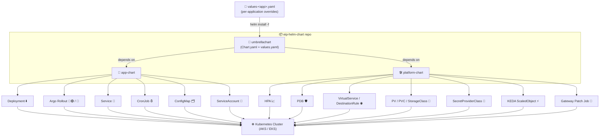
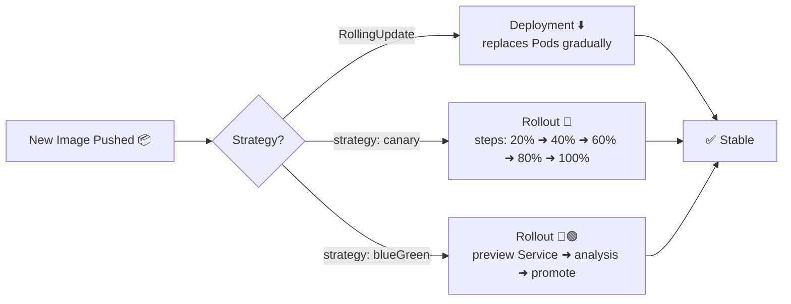
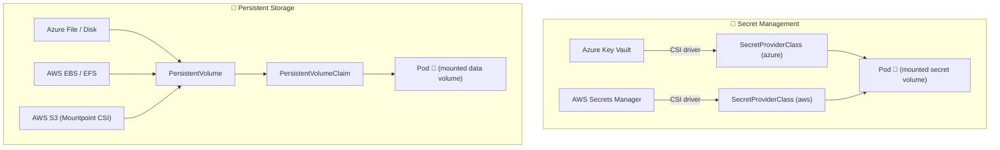
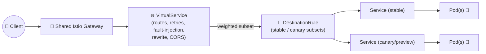
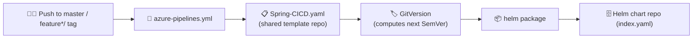

# 🚢 EIP Helm Chart

> **Umbrella Helm chart** that deploys and manages applications on Kubernetes (AKS/EKS) with built‑in support for Deployments, Argo Rollouts (Canary/Blue‑Green), CronJobs, Istio traffic management, Autoscaling, Storage, Secrets and Observability (APM/AppDynamics).

    

---

## 📑 Table of Contents

1. [🔎 Overview](#-overview)
2. [🏗️ Architecture](#️-architecture)
3. [📂 Repository Structure](#-repository-structure)
4. [🧩 The Three Charts](#-the-three-charts)
5. [🚀 Getting Started](#-getting-started)
6. [🔀 Deployment Strategies](#-deployment-strategies)
7. [📦 Supported Kubernetes Objects](#-supported-kubernetes-objects)
8. [⚙️ Sample `values-*.yaml` Files](#️-sample-values-yaml-files)
9. [🔐 Secrets & 💾 Storage](#-secrets--storage)
10. [📈 Autoscaling & Resilience](#-autoscaling--resilience)
11. [🌐 Istio Traffic Management](#-istio-traffic-management)
12. [🔄 CI/CD Pipeline](#-cicd-pipeline)
13. [🏷️ Versioning](#️-versioning)
14. [🩺 Troubleshooting Tips](#-troubleshooting-tips)
15. [📜 Changelog](#-changelog)

---

## 🔎 Overview

This repository is a **Helm umbrella chart** (`umbrellachart`) used by EIP teams (e.g. PepsiCo IVR, Savvy, Fivestar apps) to deploy workloads to Kubernetes in a **standard, reusable and configuration‑driven** way.

Instead of hand‑writing YAML manifests, teams only maintain a small **`values-<app>.yaml`** override file. The umbrella chart combines two sub‑charts to render the full set of Kubernetes objects:

| Sub‑chart | Responsibility |
|---|---|
| 🧱 **`app-chart`** | Workload objects → `Deployment` / `Rollout`, `Service`, `CronJob`, `ConfigMap`, `ServiceAccount`, `Experiment`, `AnalysisTemplate` |
| 🛠️ **`platform-chart`** | Platform/infra objects → `HPA`, `PDB`, `VirtualService`, `DestinationRule`, `EnvoyFilter`, `PV`/`PVC`, `StorageClass`, `SecretProviderClass`, `KEDA ScaledObject`, Gateway‑patch `Job` |

---

## 🏗️ Architecture



**Flow, step‑by‑step:**

1. ➡️ A team creates a `values-<app>.yaml` file with only the settings that differ from the defaults.
2. ➡️ `helm install/upgrade` renders the **umbrellachart**, which pulls in **app-chart** ➕ **platform-chart** as dependencies.
3. ➡️ Each sub‑chart renders its templates *conditionally*, based on `enabled` flags in `values.yaml` (e.g. `global.deployment.enabled`, `global.rollout.enabled`, `platform-chart.virtualService.enabled`).
4. ⬇️ Final manifests are applied to the target **Kubernetes namespace**.
5. 🔁 A **post‑install/post‑upgrade Helm hook** (`gw-patch-job.yaml`) patches the shared Istio Gateway with the app's host, if a `VirtualService` is enabled.

---

## 📂 Repository Structure

```text
eip-helm-chart/
│
├── 📄 azure-pipelines.yml          ➜ CI/CD pipeline entry point
├── 📄 GitVersion.yml               ➜ Semantic version calculation rules
├── 📄 index.yaml / manifest.yaml   ➜ Helm repo index / sample app config
├── 📄 values-*.yaml                ➜ Real-world example overrides (per app/scenario)
│
├── 📁 app-chart/                   🧱 Workload sub-chart
│   ├── Chart.yaml
│   ├── values.yaml
│   └── templates/
│       ├── deployment.yaml         ⬇️  Standard Kubernetes Deployment
│       ├── rollout.yaml            🔵🟢 Argo Rollouts (Canary / Blue-Green)
│       ├── service.yaml            🔌  ClusterIP/NodePort/LoadBalancer Service
│       ├── cronjob.yaml            ⏰  Scheduled batch Jobs
│       ├── experiment.yaml         🧪  Argo Rollouts Experiment
│       ├── analysistemplate.yaml   📊  Argo Rollouts AnalysisTemplate
│       ├── configmap.yaml          🗂️  Key/Value ConfigMaps
│       ├── configmap-from-file.yaml 📄 ConfigMaps from file/JSON
│       ├── serviceaccount.yaml      👤  ServiceAccount + token Secret
│       └── _helpers.tpl            🧰  Shared template helpers (labels, APM/AppD sidecars)
│
├── 📁 platform-chart/               🛠️ Platform/infra sub-chart
│   ├── Chart.yaml
│   ├── NOTES.txt                    ℹ️  Post-install usage notes
│   ├── values.yaml
│   └── templates/
│       ├── hpa.yaml                 📈  HorizontalPodAutoscaler
│       ├── pdb.yaml                 🛡️  PodDisruptionBudget
│       ├── virtualservice.yaml      🌐  Istio VirtualService (routing, retries, CORS, fault injection)
│       ├── destinationrule.yaml     🎯  Istio DestinationRule (subsets, traffic policy)
│       ├── envoyfilter.yaml         🧩  Istio EnvoyFilter (Lua patches)
│       ├── gw-patch-job.yaml        🚪  Helm hook Job — patches the shared Gateway
│       ├── kedascaledobject.yaml    ⚡  KEDA autoscaling (Kafka/Redis/EventHub/Blob/Prometheus)
│       ├── pv.yaml / pvc.yaml       💾  Persistent storage (Azure Disk/File, AWS EBS/EFS/S3)
│       ├── storageclass.yaml        🗄️  StorageClass definitions (Azure/AWS)
│       └── secretProviderClass.yaml 🔐  Azure Key Vault / AWS Secrets Manager via CSI driver
│
└── 📁 umbrellachart/                🚢 Parent chart — glues everything together
    ├── Chart.yaml                   (declares app-chart + platform-chart as dependencies)
    ├── values.yaml                  (toggles: app-chart.enabled / platform-chart.enabled)
    ├── values-overrides-dev.yaml    🧪  Full example: Azure dev environment
    ├── values-overrides-aws.yaml    ☁️  Full example: AWS environment
    ├── values-overrides-aws-s3.yaml 🪣  Full example: AWS S3 mount
    ├── values-cronjob.yaml          ⏰  Full example: CronJob only
    ├── values-apm.yaml              📡  Full example: APM / AppDynamics sidecar
    ├── values-sidecar.yaml          🧷  Full example: generic sidecar container
    ├── values-envoy.yaml            🧩  Full example: EnvoyFilter
    └── templates/_helpers.tpl
```

---

## 🧩 The Three Charts

### 🚢 1. `umbrellachart` (the entry point you actually install)

* Declares `app-chart` and `platform-chart` as **file‑based dependencies**.
* `global.*` values are shared across both sub‑charts (namespace, labels, feature toggles).
* You always run `helm install/upgrade` **against this chart**.

### 🧱 2. `app-chart` — application workload

| Feature | Controlled by | Renders |
|---|---|---|
| Deployment | `global.deployment.enabled: true` | `Deployment` + `Service` |
| Argo Rollout (Canary/Blue‑Green) | `global.rollout.enabled: true` | `Rollout` (+ preview `Service`) |
| Argo Experiment | `experiment.enabled: true` | `Experiment` |
| Analysis (metrics gates) | `analysisTemplates.enabled: true` | `AnalysisTemplate` |
| CronJob(s) | `cronjob.enabled: true` (per item in `cronjobs[]`) | `CronJob` |
| ConfigMap (key/value) | `configmaps.enabled: true` | `ConfigMap` |
| ConfigMap (from file/JSON) | `configmapFromFile.enabled: true` | `ConfigMap` |
| ServiceAccount | `serviceAccount.create: true` | `ServiceAccount` + token `Secret` |
| APM (Elastic) sidecar | `apm.enabled: true` | init‑container + env + volume |
| AppDynamics sidecar | `appD.enabled: true` | init‑container + env + volume |

> ⚠️ **Mandatory:** `global.labels.app` must always be set — the chart will `fail()` the render otherwise (used for labels/selectors everywhere).

### 🛠️ 3. `platform-chart` — platform & infrastructure

| Feature | Controlled by | Renders |
|---|---|---|
| Autoscaling (CPU/Mem) | `autoscalingEnabled: true` | `HorizontalPodAutoscaler` |
| Autoscaling (event‑driven) | `keda.enabled: true` | `ScaledObject` (+ `TriggerAuthentication`) |
| Disruption budget | `pdbEnabled: true` | `PodDisruptionBudget` |
| Istio routing | `virtualService.enabled: true` | `VirtualService` |
| Istio traffic policy | `destinationRule.enabled: true` | `DestinationRule` |
| Istio filter (Lua) | `envoyfilter.enabled: true` | `EnvoyFilter` |
| Persistent storage | `pv.enabled` / `awsPV.enabled` + `global.pvc.enabled` | `PersistentVolume` + `PersistentVolumeClaim` |
| Storage classes | `storageClass.enabled` / `awsStorageClass.enabled` | `StorageClass` |
| Secrets from vault | `global.secretManagement.enabled` / `global.awsSecretManagement.enabled` | `SecretProviderClass` |
| Gateway registration | *(automatic, Helm hook)* | post‑install/upgrade `Job` that patches the shared Gateway |

---

## 🚀 Getting Started

### ✅ Prerequisites

* Helm v3.x
* `kubectl` access to the target AKS/EKS cluster & namespace
* (Optional) [Argo Rollouts](https://argo-rollouts.readthedocs.io/) CRDs/controller installed, if using Canary/Blue‑Green
* (Optional) [KEDA](https://keda.sh/) installed, if using event‑driven autoscaling

### 1️⃣ Update chart dependencies

```powershell
cd umbrellachart
helm dependency update
```

### 2️⃣ Validate the rendered manifests (dry‑run)

```powershell
helm template my-release . -f values-overrides-dev.yaml
```

### 3️⃣ Install / Upgrade

```powershell
helm upgrade --install my-release . `
  -f values-overrides-dev.yaml `
  --namespace test `
  --create-namespace
```

### 4️⃣ Verify

```powershell
kubectl get deploy,svc,hpa,pdb,virtualservice,cronjob -n test
```

> 💡 Each real‑world scenario file at the **repo root** (`values-fivestar-ivr-*.yaml`, `values-cronjob.yaml`, `values-apm.yaml`, `values-pod-info.yaml`, `values-savvy-customer.yaml`) is a ready‑to‑use example — copy the closest match and adjust it for your app.

---

## 🔀 Deployment Strategies

The chart supports **three** ways to roll out a new version, chosen via `global.deployment.enabled` / `global.rollout.enabled` / `global.rollout.strategy`.



| Strategy | How it works | Where configured |
|---|---|---|
| ⬇️ **RollingUpdate** (default) | Standard K8s `Deployment` replaces Pods a few at a time (`maxSurge`/`maxUnavailable`) | `strategy.rollingUpdate` in `app-chart/values.yaml` |
| 🐤 **Canary** | Argo `Rollout` shifts traffic in weighted steps with pauses, optionally gated by `AnalysisTemplate` metrics, using Istio `VirtualService`/`DestinationRule` subsets | `global.rollout.strategy: canary` |
| 🔵🟢 **Blue‑Green** | Traffic instantly switches from the *active* to the *preview* Service after (optional) pre/post promotion analysis | `global.rollout.strategy: blueGreen` |

---

## 📦 Supported Kubernetes Objects

| Object | Emoji | Chart | Since |
|---|---|---|---|
| Deployment | ⬇️ | app-chart | v1.0.0 |
| Service | 🔌 | app-chart | v1.0.0 |
| ConfigMap (key/value) | 🗂️ | app-chart | v1.0.0 |
| ConfigMap (from file/JSON) | 📄 | app-chart | v1.0.0 / v2.1.41 |
| ServiceAccount | 👤 | app-chart | v1.0.0 |
| CronJob | ⏰ | app-chart | v1.1.0 |
| Argo Rollout (Canary/Blue‑Green) | 🔵🟢🐤 | app-chart | v2.2.1 |
| Argo Experiment | 🧪 | app-chart | — |
| AnalysisTemplate | 📊 | app-chart | — |
| DestinationRule | 🎯 | platform-chart | v1.0.0 |
| VirtualService | 🌐 | platform-chart | v1.0.0 |
| EnvoyFilter | 🧩 | platform-chart | v2.1.34 |
| Gateway Patch Job | 🚪 | platform-chart | v1.1.1 |
| HorizontalPodAutoscaler | 📈 | platform-chart | v1.0.0 |
| PodDisruptionBudget | 🛡️ | platform-chart | v1.0.0 |
| PersistentVolume / Claim | 💾 | platform-chart | v1.0.0 |
| StorageClass (Azure/AWS) | 🗄️ | platform-chart | v1.0.0 / v2.1.40 |
| SecretProviderClass (Azure KV / AWS SM) | 🔐 | platform-chart | v1.0.0 |
| KEDA ScaledObject | ⚡ | platform-chart | v2.1.41 |
| S3 static PV (Mountpoint CSI) | 🪣 | platform-chart | v2.2.3 |

---

## ⚙️ Sample `values-*.yaml` Files

| File | Scenario | Key toggles |
|---|---|---|
| [`values-fivestar-ivr-blue-green.yaml`](values-fivestar-ivr-blue-green.yaml) | 🔵🟢 Blue‑Green rollout | `rollout.strategy: blueGreen`, pre/post‑promotion analysis |
| [`values-fivestar-ivr-dynamicscale.yaml`](values-fivestar-ivr-dynamicscale.yaml) | 📈 Dynamic HPA scaling | `autoscalingEnabled`, `hpaBehavior` |
| [`values-fivestar-ivr-experiment.yaml`](values-fivestar-ivr-experiment.yaml) | 🧪 Argo Experiment | `experiment.enabled` |
| [`values-fivestar-ivr-rollout-with-exp.yaml`](values-fivestar-ivr-rollout-with-exp.yaml) | 🐤 Canary + Experiment combo | `rollout.strategy: canary` + `experiment` |
| [`values-fivestar-ivr-stablescale.yaml`](values-fivestar-ivr-stablescale.yaml) | ⚖️ Stable scaling policy | `hpaConfigMinReplicas/MaxReplicas` |
| [`values-cronjob.yaml`](values-cronjob.yaml) | ⏰ Scheduled job only (no Deployment/Service) | `app-chart.cronjob.enabled: true` |
| [`values-apm.yaml`](values-apm.yaml) | 📡 Elastic APM & AppDynamics sidecars | `apm.enabled` / `appD.enabled` |
| [`values-pod-info.yaml`](values-pod-info.yaml) | 🌐 HPA + PDB + VirtualService + DestinationRule demo | multiple |
| [`values-savvy-customer.yaml`](values-savvy-customer.yaml) | 🔐 Azure Key Vault secret sync + HPA/PDB | `secretManagement.enabled` |

---

## 🔐 Secrets & 💾 Storage



* `global.secretManagement.enabled` → syncs Azure Key Vault secrets/certs into a native K8s `Secret` via `secrets-store.csi.x-k8s.io`.
* `global.awsSecretManagement.enabled` → same pattern, backed by AWS Secrets Manager (supports `jmesPath` extraction).
* `platform-chart.pv` / `awsPV` → static `PersistentVolume` provisioning (Azure File/Disk, AWS EBS/EFS, or **read‑only S3 buckets** since v2.2.3).
* `global.pvc.enabled` → creates the matching `PersistentVolumeClaim` and mounts it on the workload.

---

## 📈 Autoscaling & Resilience

| Mechanism | Purpose | Values key |
|---|---|---|
| 📈 HPA | Scale on CPU/Memory utilization | `platform-chart.autoscalingEnabled`, `targetCPUUtilizationPercentage`, `targetMemoryUtilizationPercentage`, `hpaBehavior` |
| ⚡ KEDA | Scale on Kafka lag, Redis, EventHub, Azure Blob, Prometheus queries (down to 0 replicas) | `platform-chart.keda.enabled`, `keda.triggers[]` |
| 🛡️ PDB | Guarantee minimum availability during node drains/upgrades | `platform-chart.pdbEnabled`, `pdbMinAvailable` / `pdbMaxUnavailable` |
| 🧭 Topology Spread | Spread Pods across hosts/zones | `app-chart.topologySpreadConstraints.enabled` |

---

## 🌐 Istio Traffic Management



* The **`gw-patch-job.yaml`** runs as a **Helm post‑install/post‑upgrade hook** to register the app's `VirtualService` host on the shared namespace Gateway automatically (`<namespace>-cv-gw`), for both AKS and EKS.
* `virtualService.routes[]` support: path prefixes, header matching, `rewrite`, `retries`, `fault` injection, weighted `destinations`, and `corsPolicy`.
* `envoyfilter.yaml` allows injecting custom Lua filters at the HTTP Connection Manager level.

---

## 🔄 CI/CD Pipeline



* Pipeline defined in [`azure-pipelines.yml`](azure-pipelines.yml); triggers on `master` branch pushes and `master*`/`feature*` tags.
* Shared stage template comes from the `EIAP_Devops/eip-helm-chart-pipeline-template` repository.
* Versioning rules for `GitVersion` live in [`GitVersion.yml`](GitVersion.yml):

| Branch pattern | Version bump |
|---|---|
| `bugfix/*` | Patch (x.y.**Z**) |
| `feature/*` | Minor (x.**Y**.0) |
| `release/*` | Major (**X**.0.0) |

---

## 🏷️ Versioning

* Chart version: `umbrellachart/Chart.yaml` → **`version`** (bumped for every chart/template change).
* Dependencies pinned: `app-chart` and `platform-chart` versions must match what's declared in `umbrellachart/Chart.yaml` → `dependencies[]`.
* Run `helm dependency update` after bumping a sub‑chart version.

---

## 🩺 Troubleshooting Tips

| Symptom | Likely cause | Fix |
|---|---|---|
| ❌ `execution error … "app, version, component labels are mandatory"` | `global.labels.app` missing | Set `global.labels.app` in your values file |
| ❌ Gateway patch `Job` fails | Wrong `destination.jobServiceAccount` / `jobNS` permissions | Verify `destination.*` values & RBAC |
| ⚠️ `VirtualService` created but no traffic | Gateway not patched yet, or host doesn't match `.intra.pepsico.com` regex | Check `gw-patch-job` logs, confirm `virtualService.hosts` |
| ⚠️ HPA has 0 metrics | Metrics‑server / KEDA not installed on cluster | Install metrics‑server or KEDA CRDs |
| ⚠️ PV stuck `Pending` | Wrong `storageClass` name or CSI driver not installed | Confirm `storageClass.enabled` and driver availability |

---

## 📜 Changelog

> Full historical release notes — newest changes at the bottom. See linked example file for each feature.

| Version | Highlights | Example file |
|---|---|---|
| **v1.0.0** | 🎉 Stable release — Deployment, Service, ConfigMap (KV & file), ServiceAccount, DestinationRule, VirtualService, HPA, PDB, PV, PVC, StorageClass, SecretProviderClass | `umbrellachart/values-overrides-dev.yaml` |
| **v1.1.0** | ⏰ CronJob support | `umbrellachart/values-cronjob.yaml` |
| **v1.1.1** | 🚪 Gateway name support in VirtualService for custom domains | `umbrellachart/values-overrides-dev.yaml` |
| **v1.1.2** | ✏️ URI rewrite support in VirtualService | `umbrellachart/values-overrides-dev.yaml` |
| **v2.0.0** | 🌐 Istio decentralization support; labels added to all K8s objects | — |
| **v2.1.2** | 🪝 Working Helm install hook | — |
| **v2.1.29** | 🐛 Fixed post‑install hook label issue | — |
| **v2.1.30** | 🔧 Fixed post‑install job name & PV name (env suffix added) | — |
| **v2.1.31** | 🔁 Added retries & fault‑injection to VirtualService | — |
| **v2.1.34** | 🧷 Fixed sidecar container & EnvoyFilter bugs; global labels drive default manifest generation | — |
| **v2.1.35** | ✂️ Fixed Gateway‑patch job name length; fixed PV issue | — |
| **v2.1.36** | 🚪 Fixed Gateway‑patch job when VirtualService disabled | — |
| **v2.1.37** | 🐛 Fixed CronJob labels issue | — |
| **v2.1.40** | ☁️ AWS EKS cluster resource support; CronJob parallelism changes | — |
| **v2.1.41** | 🗂️ ConfigMaps support JSON files; KEDA CPU/Memory/Prometheus scalers | — |
| **v2.2.0** | 📡 CronJob supports AppD/APM/initContainers; KEDA Azure Blob scaler; custom APM image; Gateway‑patch job supports AKS+EKS+ingress‑only | — |
| **v2.2.1** | 🕐 CronJob timezone support; 🔵🟢🐤 Argo Rollouts Blue‑Green/Canary support | — |
| **v2.2.3** | 🪣 AWS S3 static mount via Mountpoint CSI driver (`awsPV.isS3=true`) | `umbrellachart/values-overrides-aws-s3.yaml` |

