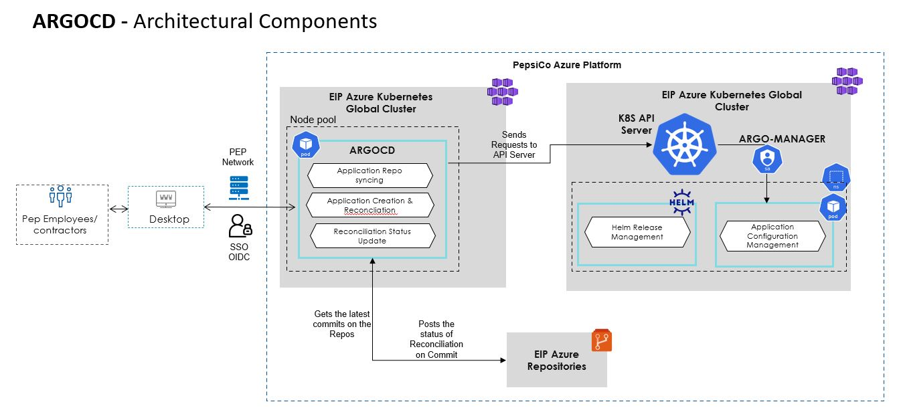
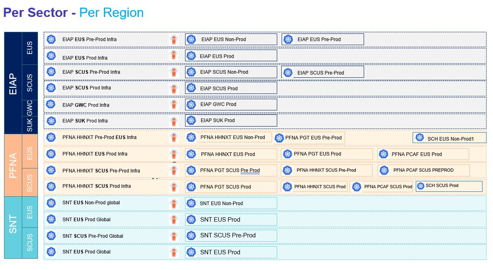
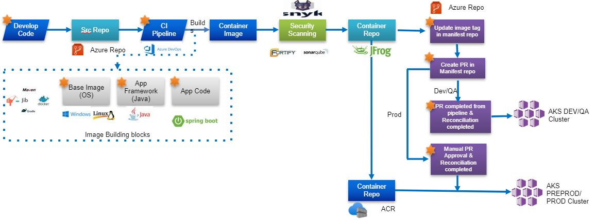

# Introduction 
This repository contains ArgoCD instance resources (configmaps, virtual services and argo_project) for the respective clusters and also bootstrap applications.

# ArgoCD cluster deployment structure

# CD process

# References
- [ArgoCD Installation](https://pepsico.sharepoint.com/:w:/r/teams/EIAP-K8SOnBoarding/Shared%20Documents/Documents/DevSecOps/ArgoCD/ArgoCD_Installation.docx?d=wc6a2f04f7d9f49958ea9cd5ddda4e52f&csf=1&web=1&e=FNr3Jm)
- [ArgoCD repositry configuration](https://pepsico.sharepoint.com/:w:/r/teams/EIAP-K8SOnBoarding/Shared%20Documents/Documents/DevSecOps/ArgoCD/EIP_ArgoCD_Configuration_v2.0.docx?d=w786668a573bd4ac38e083b936e206903&csf=1&web=1&e=b0UQcd)
- [ArgoCD Upgrade Installation](https://pepsico.sharepoint.com/:w:/r/teams/EIAP-K8SOnBoarding/Shared%20Documents/Documents/DevSecOps/ArgoCD/ARGO%20upgrade%20notes%20-%20%202.8.6%20to%202.9.5%20.docx?d=w80bad26fb10148b5926b21e75eff15d4&csf=1&web=1&e=UZkHph)