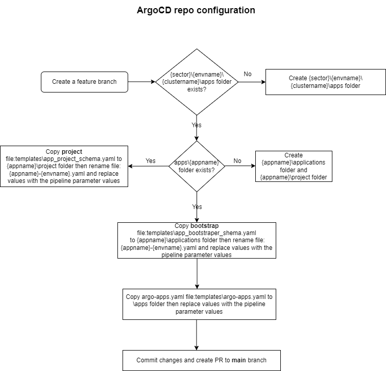

# On-board new application to ArgoCD
Automate the new argocd repository creation process
# Pre-requisites
1. Service account: svceipazdevops should have access to ArgoCD config repository.
2. argo-configs project should be created manually if not created
3. Application namespace should be available in the cluster
4. Azure AD groups should exist  

Use this pipeline to create new repository: https://dev.azure.com/PepsiCoIT/EIP-Infrastructure/_build?definitionId=31904

